Revision 2 • 31 October 2026 • Design handoff, not an implemented system
This revision adds explanations, diagrams, relationships, proposed API contracts, setup responsibilities and browser acceptance gates to the earlier summary. The earlier summary is preserved at the end for traceability. This document consolidates available conversation and the existing handoff; it cannot certify that every detail from unavailable earlier messages has been recovered.
Status legend: Confirmed direction = explicit user direction in the available conversation; carried-forward = a detail in the earlier handoff whose original approval should be checked; proposed implementation = an engineering recommendation, not an additional business approval; open = unresolved or conflicting. Nothing here means built, connected, tested or launched.
Read in this order:
1. Decision conflicts and scope.
2. Technology responsibilities and architecture.
3. Customer, team and rider sections.
4. Operational pathways and exceptions.
5. Data ownership, relationships and API contracts.
6. Security, reliability and setup responsibilities.
7. Staged implementation and launch gates.
8. Preserved earlier requirements and readiness register.
Diagrams use Mermaid, an editable text diagram format. Open in a Mermaid-capable Markdown viewer to render them. Every diagram also has a prose explanation. This is intentionally suitable for Codex to maintain beside the code.
The following table overrides any implication that all values in the preserved summary are final. Do not silently choose a value because it appears most often.
Clear user directions include Next.js/React, Django/DRF, Supabase database and storage, Resend, Paystack, optional customer accounts, wishlist for signed-in customers, individual team accounts, protected complaint images, rider management, silent notifications, editable operational guidelines, no authenticator-app requirement, no enforced purchase minimum, and browser review between build stages.
Recommended architecture: one modular Django application with clear internal modules, one Next.js application with role-appropriate sections, PostgreSQL and protected file storage. Avoid splitting every module into a separate service at launch.
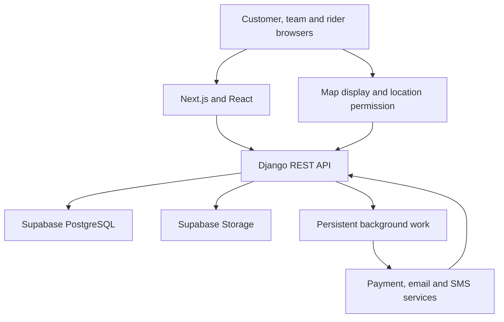
Django records the durable intent before asynchronous work. Provider callbacks return to Django, where authenticity and state are checked. Rider coordinates arrive from the device; the map is a presentation layer. Proposed same-site routing or carefully configured cookies/CORS/CSRF must be designed before production.
Riders see assigned work, relevant destination/contact information, their availability, issue reporting, handover verification and a prominent call-for-help action. Their assignment remains recorded if they log out or lose connectivity. Location and order access must stop when authorisation ends; a rider must not browse all customers or retrieve the customer's secret handover code.
This is a proposed enforcement matrix based on the design, not a grant of permissions to actual people. Owner access remains audited and constrained by valid state transitions.
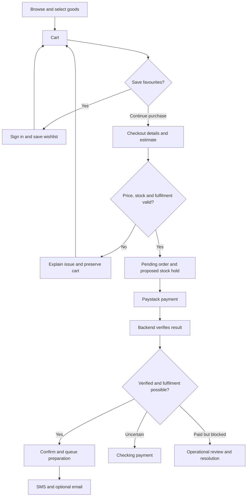
Customers may edit the cart before the pending payment snapshot is created. Once payment starts, do not mutate the amount of that payment attempt. Proposed handling for an edit at this stage: return to cart through an explicit change-order action, reconcile the existing attempt and create a new reviewed checkout snapshot when safe. The exact business rule remains open. After confirmation, additional goods require another order; no ten-minute add-on window is assumed.
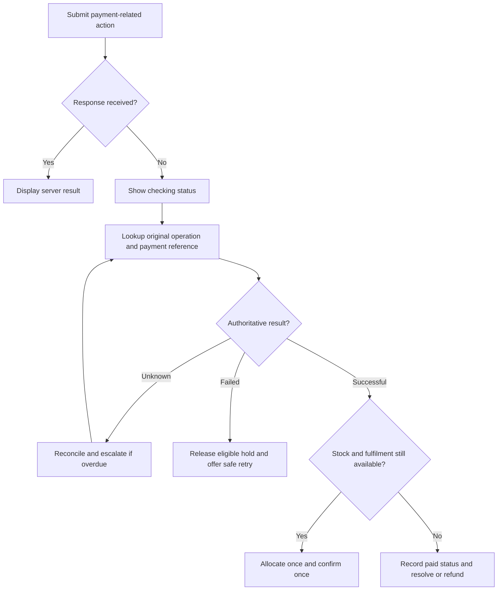
A client retry uses the same operation identity for the same action. A new idempotency key is not a substitute for checking an uncertain previous payment. Expiring stock does not declare the payment failed. Multiple successful attempts must be recorded and reconciled; they must not trigger duplicate preparation.
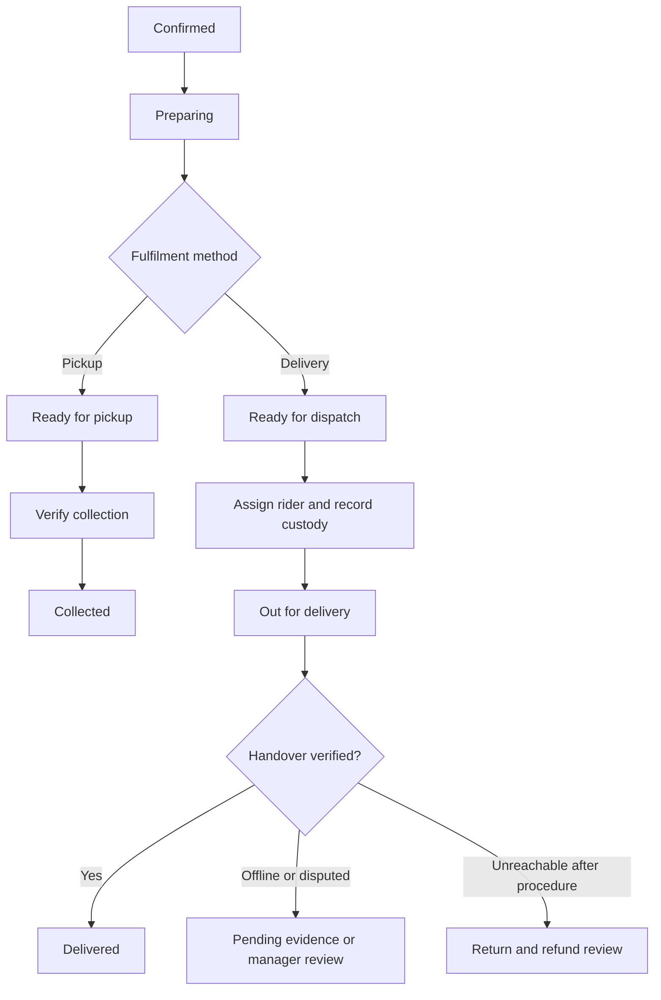
Holds are recorded separately with reason, responsible person, start time and previous stage. Clearing a hold resumes only a valid state; it must not bypass payment or handover checks. Cancellation is permitted only under the applicable stage policy and does not mean money is refunded.
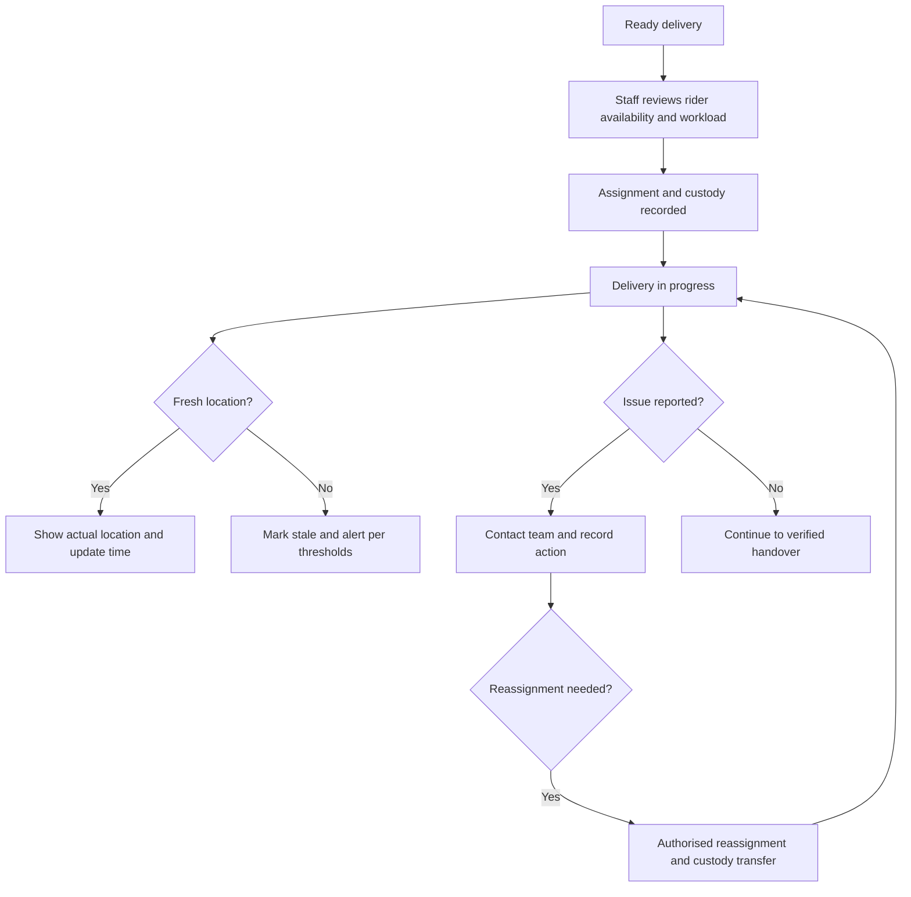
Availability values are Available, On delivery, Unavailable and Off duty, with update time. Available is not a capacity guarantee. Multiple orders require staff judgement. Rain, traffic and breakdowns change estimates; staff communicate delays. Two-minute stale and five-minute alert thresholds are proposed configurable values. Tracking reliability on locked/background mobile browsers is a launch feasibility test, not a promise.
For an unreachable customer, follow the approved contact procedure and log actual attempts. The carried-forward procedure is three rider attempts over five minutes plus a team attempt; verify that precise timing before configuration. Returned goods enter inspection/quarantine. No redelivery; customer may place a new order. Refund product costs according to eligibility and disclose delivery-fee treatment; Fresavelle-caused complete failure refunds the full amount.
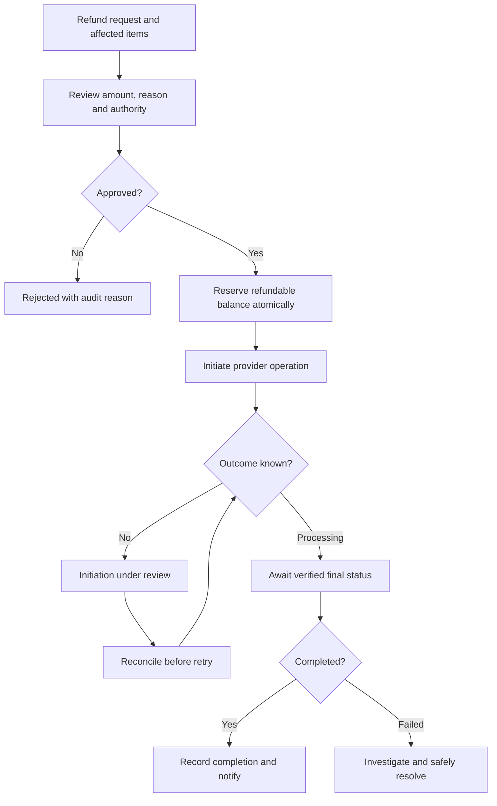
Calculate eligible balance per successful payment: paid amount minus completed refunds minus approved/in-flight/uncertain refund commitments. Do not release an uncertain commitment solely because a request timed out. Partial refunds can leave a valid remaining balance. Separate request, approval, provider initiation and completion, preserving actors and timestamps. Automatic restocking is not a consequence of issuing a refund.
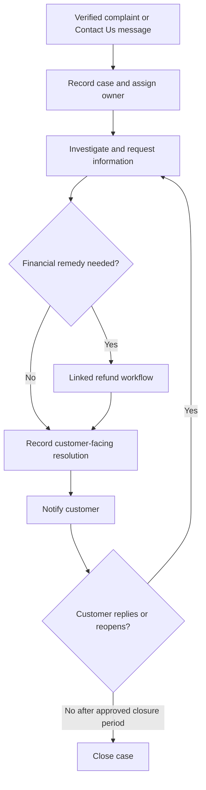
Complaints about an order require verified ownership. A general contact message does not establish ownership just by quoting an order reference. Internal notes stay private. Attachments require size/type limits, validation, private access and retention rules. Closure after seven days is a proposed starting policy; the preserved summary adds delivered-notification gating, which needs confirmation. Refund completion does not automatically resolve a complaint.
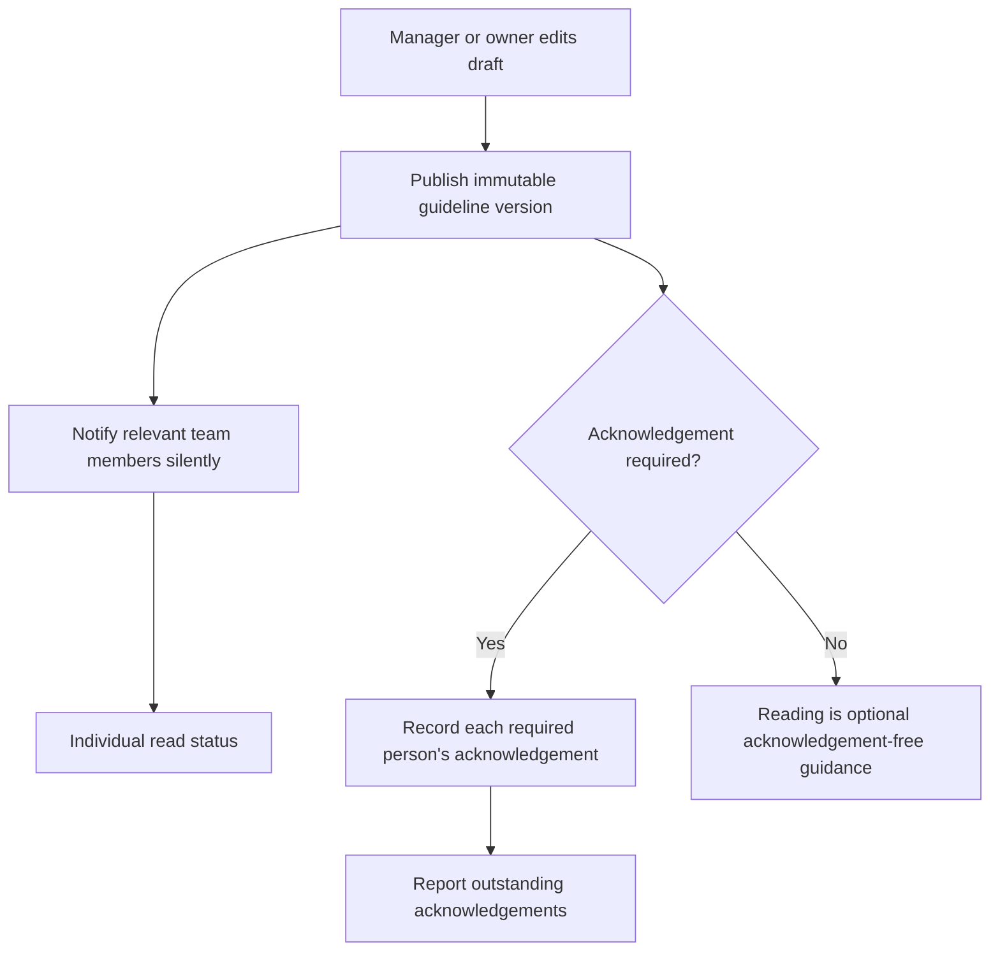
Each article should include situation, responsible role, steps, escalation contact, customer wording, related links and last update. Important versions may require acknowledgement; minor corrections need not. Acknowledgement names the exact version. Publishing wording does not change executable business rules: a new cancellation rule also needs configuration/code review and tests.
Notification event, recipient read state, acknowledgement and underlying task status are separate records. For example, three staff can read “New order” while that order remains unprepared. Record created time and seen/read time individually. No sound alerts.
Shared application data is not synonymous with temporary frontend state: the order list may be cached in the browser, but the durable order belongs to the backend. Cache expiry must never reverse a paid order or revoke a recorded handover.
These diagrams show conceptual relationships; implementation must still specify nullable fields, constraints, deletion policies, indexes and migrations.
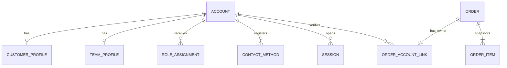
One account can have customer and team profiles, but team permissions require an authorised role assignment. A guest order has no account link until verification. At most one active customer ownership link per order is the proposed constraint; transfers require an audited dispute process. Roles should not be a single string that prevents legitimate multiple responsibilities.
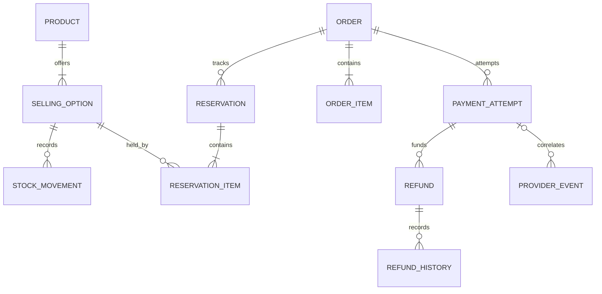
Provider events may arrive before correlation is possible, so store valid uncorrelated events for investigation. Refund events also need correlation to their refund; a generic provider-event record must support both types. Preserve original product names, unit descriptions and integer-kobo prices on order items even when catalogue entries are renamed or archived.
Inventory balances need one explicit accounting convention. Proposed formula, if on-hand includes both held and allocated goods: available = sellable on-hand − active reservation quantity − committed allocation quantity. Shipping then reduces on-hand and clears that allocation in one consistent operation. Never subtract the same quantity as both custody and commitment. Returned goods are not sellable until inspection.
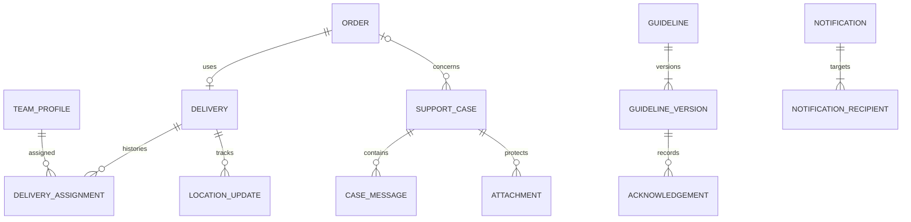
Custody events, delivery issues and handover proofs supplement delivery assignments. Case messages distinguish public reply from internal note. Notification delivery attempts to SMS/email are separate from staff recipient read status. Records not drawn include addresses, carts, recovery reviews, audit history, reconciliation runs and outbox jobs.
- Unique order reference; unique provider transaction identity within the appropriate provider/environment scope.
- Unique idempotency scope/key, storing request fingerprint and operation result. Same key with a different payload is rejected.
- Nonnegative stock quantities and valid allocation totals according to the chosen accounting convention; positive purchasable quantities.
- Integer-kobo financial amounts and explicit currency; protect aggregate refund balance under concurrency.
- One active ownership link per order; unique wishlist account/selling-option pair and acknowledgement account/version pair.
- Index order status/created time for queues, customer link/order date for history, rider assignment/status for work, and reservation status/expiry for cleanup.
- Index payment reference, refund state, provider processing state, case assignee/state and recipient/unread/created time.
- Design text search from actual catalogue queries; use query plans to validate indexes. Avoid adding indexes indiscriminately.
- Preserve financial snapshots and audit history; deleting an account must not cascade-delete orders, refunds or necessary evidence.
Routes below are design proposals, not existing endpoints. Use a consistent /api/v1 prefix. Resolve authentication and exact schemas before implementation.
Common contract: stable error code, readable message, field errors where appropriate, request/operation reference and authoritative current state when relevant. Return an asynchronous operation identifier when work continues. Authorisation is checked on every referenced record, including attachments and downloads. Rate-limit signals should include a retry delay without exposing private account existence.
ACID and concurrency. Commit order snapshots and chosen stock allocation atomically. Lock or atomically update relevant stock/refund balances; process records in a consistent order to limit deadlocks. Store a durable notification/job intent in the same transaction. Perform slow external calls outside locked database transactions. A database transaction cannot roll back a payment already processed by Paystack; reconciliation resolves that boundary.
Idempotency. Stable operation identifiers protect order creation, payment initiation, refunds, handover and notification processing. Database uniqueness and conditional transitions back up application checks. A repeated event may be safely acknowledged without repeating its business effect. Do not assume every provider event includes a unique event ID.
Authentication and abuse control. Secure HttpOnly cookies, HTTPS, CSRF protection where cookie authentication is used, explicit allowed origins, password hashing, permission checks and session revocation. Rate-limit login, OTP issue/verify, recovery, guest tracking, contact forms, uploads and sensitive actions using relevant account/contact/IP signals. Distributed instances require coordinated limits. Protect short OTPs against offline brute force using an appropriate keyed/protected verifier, expiry and atomic one-use consumption; do not log secrets.
Files and data. Validate uploads, restrict file size/type, generate server-owned paths, prevent cross-customer access and use expiring authorised downloads where appropriate. Keep storage service credentials server-side. Retention and deletion policies must cover records, files, logs and backups.
Caching. Cache public catalogue data when beneficial, invalidate or revalidate on catalogue changes, and isolate private data. Always recheck authoritative price, stock, ownership and refundable balance during mutations. Never reuse one customer's authenticated response for another.
Outages and jobs. Define bounded retries with backoff, escalation for stuck jobs, monitoring and durable recovery. Restore-test database and uploaded files. During recovery reconcile uncertain payments/refunds, expired holds, orders, delivery custody and notification queues. Two-hour service recovery is a target, not a guarantee; recovery-point objective remains open.
Acceptance evidence. Test two buyers for the last item, two refund requests for the same balance, duplicate webhooks, a lost successful response, expired reservation followed by late payment, inaccessible private attachments, revoked sessions, invalid role actions and stale rider coordinates. Include these beside the relevant feature; do not defer all security until launch.
This is a setup sequence, not verified current provider-console instructions. At each integration stage Codex should check current official documentation and provide the exact steps for that stage. No accounts, domains, subscriptions or integrations are asserted to exist.
Store secrets in local environment files excluded from version control and hosting secret settings. Do not paste passwords, private keys, OTPs or live customer data into chat. Tell the user exactly which variable is needed, where to obtain it, where to put it and how to check it without printing its value. Use test providers or clearly labelled adapters until real integration is approved.
Working agreement: finish one reviewable stage, run appropriate checks, provide the exact running URL and test instructions, then wait for the user's review before beginning the next stage. Changes requested during review belong to the current stage. A mock must be labelled; a frontend success animation is not proof that a backend integration works.
Provider email/SMS may be wired earlier when identity needs it, while broader communications are reviewed in stage 9. Security and auditing are built throughout. Purchasing, advanced CRM and financial reporting require explicit detail before their implementation; their mere presence in the navigation is not completion.
At each stage Codex reports: what changed; what is real versus mocked; checks passed/failed; exact URL; numbered browser actions and expected outcomes; remaining limitations; user setup needed now. Do not ask the user to configure every service on day one.
Read this blueprint and the preserved requirements. Treat section A as the override for conflicting decisions. Inspect the existing repository before choosing implementation details. Use Next.js/React, Django/DRF and the selected providers; propose any change explicitly. Build in the stages above, with security, ACID transactions, indexes, idempotency, rate limits and failure handling included with each relevant feature. Before each external setup, explain the service, required account settings, secure configuration steps and how we will test it using current official documentation. After each stage, run checks and give me the exact browser URL, what to click and expected outcomes. Wait for my review before moving to the next stage. Label all mock behaviour and do not claim provider connections or production readiness without evidence. Keep this blueprint, a decision log and launch register updated. Resolve only decisions blocking the current stage; avoid repeatedly asking me to approve already-settled rules.
The design is ready to guide staged implementation after the first-stage conflicts are addressed; it is not a claim of exhaustive recovery of all earlier conversation or a final executable schema. Celebrate the team's contributions at the end of the agreed work, as requested: “To everyone who helped shape Fresavelle—and to building something customers and the team can trust.”
The text below is retained for traceability. It is subject to the conflict/status notes in section A and is not independent proof that every listed detail was finally approved.
Working handoff for Codex · 31 October 2026
This is a consolidated starting specification assembled from the decisions visible in the current conversation. It is not a verbatim transcript, a completed implementation, or an independently verified full history. Some earlier discussion was not available in full; confirm missing details before implementation. Approved means approved for design, not built or tested. Suggested names, owners and technical implementations are not appointments or completed work. More recent explicit decisions override earlier summaries.
- Fresavelle sells its own groceries, foodstuffs, fruit and vegetables in Abuja at launch, to households, restaurants and companies at the same listed prices. Use web and mobile browsers; no native app is selected.
- No enforced minimum for any customer; even orders of ₦3,000 or less are permitted. Show delivery fee separately before payment; no delivery fee for pickup. Large orders depend on stock and fulfilment capacity. No special business enquiry form; normal orders go through checkout. General Contact Us is included.
- Products: configurable categories and listings by owner and manager; pieces, fixed-weight packs, other packs and baskets. One product may have several fixed selling options, each with its own price and stock. No variable-weight pricing. Baskets have their own counts, with no automatic ingredient deduction.
- Customers see low-stock indicators and out-of-stock products; owners/managers receive configurable low-stock alerts. Exact thresholds and alert channel remain open.
- Frontend Next.js and React; Django, Python and Django REST Framework backend as a modular monolith; Render preferred for frontend and backend; Supabase PostgreSQL and Storage; Paystack payments; Resend email; Termii provisional SMS subject to rate and network tests; maps provider open.
- Customer storefront, management dashboard, mobile-friendly rider page, backend/API, database, protected file storage, payment, email, SMS and map dependencies. Build and validate real integrations; do not claim any are already configured.
- Owner, manager, staff and rider have individual accounts. Shared account system with separate profiles and explicit roles; customer and team capabilities may coexist only after authorised assignment. Owner alone promotes managers and controls delivery areas and charges. Owner and manager manage products and categories and approve staff stock adjustments; refund authority limits remain open. Rider access restricted to assigned work.
- Guests can browse, use a cart and check out without registering. Guest cart retained for 30 days after last change in same browser where identifier persists. Account cart and wishlist persist across devices; wishlist requires sign-in. Preserve intended wishlist action through sign-in.
- Customer may consent to merging guest and account carts; retain larger quantity for duplicate selling options, then recheck availability and limits. Cart and wishlist do not hold prices or stock. The rules for cart changes while a payment is pending remain open.
- Calculate totals on server; show current price, delivery fee and a realistic fulfilment estimate before payment. No customer-selected delivery/pickup slots and no slot reservation. If busy continue accepting with a reliable later estimate; if no reliable estimate for either available fulfilment method, preserve cart and pause payment until reviewed.
- Create pending order and order snapshots, plus 15-minute stock reservation, safely together before redirect to payment. Snapshot item, unit, quantity, price, discount, fees and total. A pending order is not confirmed; redirect is not payment proof. Verify Paystack server-side against reference, amount, currency and environment, and process authenticated repeated updates safely. Confirm order and commit inventory only after successful payment and fulfilment checks; notify SMS and email if provided. Confirmed orders are not customer-edited; new items require a new order.
- Reservation expires at original deadline, regardless of verification delays. Payment verification continues independently. Late success: record payment and automatically check and allocate new available stock if all fulfilment checks pass; otherwise order awaiting confirmation on operational hold. No double allocation. Definitive failure releases any active reservation safely; uncertain payment stays under verification, using original reference, and alerts staff; do not claim failure from timeout.
- Initial same-day delivery cut-offs: weekdays 4 pm with delivery ending 6 pm; Saturday 3 pm ending 5 pm; Sunday 1 pm ending 3 pm. Show later available estimate after cut-off or when capacity unavailable. Pickup ends at store closing: weekday 7 pm, Saturday 6 pm, Sunday 4 pm. Verify full store, delivery and support opening times against earlier source before configuration.
- Pickup targets 10–20 minutes or sooner for regular orders; 30 minutes for large. Starting large-order threshold 20 units with staff flag for extra effort; adjustable. Actual ready message is the confirmation. SMS and optional email at confirmed order, pickup ready, dispatch, delivered/collected, meaningful refund/cancellation updates; substitution contact according to approved preference. Messages are tracked separately by channel.
- Live rider map at launch is a design requirement subject to real device feasibility; no misleading fake movement. Stale after 2 minutes, alert staff after 5 minutes; configurable. Location update frequency, map provider, retention and browser background feasibility are open. If unavailable, retain delivery status and display last update. Offline handover is pending verification until server validates or manager records authorised exception.
- Delivery and pickup codes entered at handover, backend verified, attempts limited, no exposure in rider responses or logs. Owner/manager authorised exception with reason and evidence if necessary; exact checks open.
- Rider page: individual login, availability, assignments, acknowledgement, tap to call support/customer as permitted, report issues and live location. Driver management includes profiles, availability, issues, history. Manual assignment; multiple deliveries only with staff judgement. Both riders confirm physical transfer by default, manager exception logged. Immediate suspension permitted while retaining custody/assignment history. No automatic assignment, route optimisation or in-app voice at launch.
- Customer unreachable: rider makes three contact attempts over five minutes, contacts team, team makes final attempt; if still unreachable rider returns order. No redelivery of returned order; customer may order again. Product costs eligible for refund, delivery fee not automatically refunded after a genuine customer-unavailable attempt; if Fresavelle/rider caused failure refund product costs and fee; if entire order cannot be fulfilled refund full amount including fee. For partial unavailable items while remainder delivered refund affected items; fee may remain. Review and disclose policy before payment and check applicable requirements.
- Goods damaged/lost while with rider: flag, report and review; cancel and refund affected items, do not send replacements. Entire unfulfilled order full refund including fee. No presumption of rider fault.
- Pickup reminder after 1 hour; staff follow-up after 2 hours or before closing if sooner. These are not cancellation deadlines. Overnight storage and cancellation/refund policy remain open. Significant delay starting thresholds: 15 min pickup, 30 min delivery, always notify delivery-day change.
- Staff identify committed damaged goods, immediately protect stock; identical replacement units may be allocated by authorised staff, with damage adjustment reviewed by manager/owner. Different substitution requires customer agreement, exact difference refunded or paid; three contact attempts and previously agreed product-based timings need verification against full earlier source.
- Order complaints accept protected pictures and verified order access. Separate support case, refund and order records; internal notes private. Resolved complaint automatically closes 7 calendar days after at least one resolution notification is confirmed delivered if no reply or reopening. If no delivery confirmation, remains resolved for staff review. Verified customer or authorised staff can reopen. Customer reopening time limit open.
- General Contact Us form feeds shared team inbox; branded outbound emails. No automatic inbound reply threading at launch until selected and tested; do not imply replies are monitored. General enquiries first response target 4 support hours, order issue 2 support hours, urgent active-delivery issue flagged immediately with phone option; targets internal.
- Customer password login using email or verified phone; optional extra sign-in verification, fresh verification for sensitive changes. Customer sessions max 7 days and 24 hours of meaningful inactivity; background calls do not extend; logout and individual/all session revocation server-enforced; password reset revokes sessions.
- Owner, manager, staff, rider password plus one-time code to verified phone or email; no authenticator app required. Owner/manager/staff session max 8 hours, idle 30 min; rider max 8 hours, idle 1 hour. Rider assignment survives logout/expiry. Starting OTP 6 digits, 5 minutes, max 5 attempts/code, resend cooldown 60 seconds, 3 per 15 min; enforce wider anti-abuse limits; test and configure.
- Guest tracking and individual guest-order linking: reference plus checkout phone plus OTP, verify on backend for the particular order; do not reveal account/order existence in pre-verification response. Shared/recycled phone numbers do not justify bulk linking. Lost reference: separate recovery; previously verified email may provide additional check, otherwise authorised support review. Order linked elsewhere not automatically transferred.
- Team recovery never changes role or bypasses permissions; individual accounts, audit and session revocation. Manager recovery requires owner; staff/rider assisted recovery by owner/authorised manager. Owner recovery uses trusted contact only as supporting evidence, not automatic access; exact protected process open.
- Account deletion requires fresh verification, clear explanation, retention review and session revocation. Active orders, refunds and complaints not automatically cancelled; detailed handling and retention open.
- Order stages: awaiting payment; awaiting confirmation; confirmed; preparing; ready for pickup; ready for dispatch; out for delivery; delivered; collected; cancelled. Customer-response and operational-review holds separate from progression. Payment, refund and order states independent. Backend validates transitions and records actor, time, prior/new state, reason; retry safe.
- Payment attempts pending/processing/verification needed/successful/failed/abandoned/reversed; exact provider mappings open. Reservation active/committed/released/expired. Refund awaiting approval/rejected/approved/initiation under review/processing/completed/failed. Notification queued/sending/accepted/delivered where reported/failed/needs review/cancelled.
- Proposed records: account, contact, sessions, challenges, recovery and verified order links; categories, products, selling options, stock balances, reservations, items, movements and holds; carts and cart items; orders and snapshots; payment attempts, provider events and refunds; delivery, assignments, custody, location, issues and handover; support cases, messages, notes and private attachments; guidelines and versions; notifications and individual recipients.
- Stock availability must not double-subtract categories or location. With-rider is a custody location; committed is allocation. On return, items held for inspection and not automatically resold. Preserve history and handle previously committed damaged units without double counting.
- Financial amounts integer kobo; link refunds to actual successful payment. Preserve append-only financial history; protect concurrent refundable balance including in-flight or uncertain refunds. Provider event identifiers may not always be unique/available; verify signatures and use provider-supported identifiers and reconciliation. Additional payment and multiple successful payments require detailed design.
- CRM, orders, inventory, purchasing, finance, reconciliation, reports/exports, support inbox, rider management, approvals, security and settings.
- Guidelines & Help Centre: owner/manager edit drafts and publish immutable versions; feedback and acknowledgements reference exact versions; mark selected changes requiring acknowledgement for relevant roles. Changes to guidance do not automatically change enforced business rules.
- Silent staff Notification Centre, role-appropriate alerts, individual read status; read, acknowledged and task completion are separate. Notifications retained 90 days; underlying unresolved work remains visible. Customer SMS/email delivery records separate. Browser notifications optional and silent where supported.
- Role and record-level backend access; no trusting frontend price or status. Private complaint files, minimised rider data, protected secrets, secure cookies, server session revocation, rate limits and per-purpose OTP controls. Secure provider calls; no card details or OTPs in logs.
- Transactions, row locking/atomic updates and constraints for stock and money; idempotency for retries; persistent notification intent (transactional outbox or equivalent), monitored background tasks, bounded retries and operational escalation. Do not hold database locks while waiting for external services. Check uncertain provider outcome before retrying.
- Appropriate indexes, efficient queries, pagination, private cache isolation; stock/payment authoritative at critical checks; avoid stale price confirmation. Track error, queue, payment and service health; alerts reachable beyond dashboard.
- Test: 20/50/100 daily orders, concurrent website users 20/50/100 including 3/10/20 checkout, plus staff and rider traffic; illustrative planning not forecast. At least 3 packers and 10 riders simultaneously; actual travel and capacity depend on conditions. Performance and correctness tested together.
- Outage response target 2 hours for critical services, not guarantee; verify payments, reservations, orders, messages and active deliveries after recovery. Preserve original reservation expiry. Restore-test both database and stored files. RPO, plans, alert contacts and procedures open.
Use separate decision status (Open/In progress/Decided) and implementation readiness (Not started/Implemented/Testing/Verified/Blocked/Not applicable with reason). Each entry needs ID, owner, approver, target, decision, affected feature, evidence and dependencies. No people, dates or tests have been assigned or completed.
Feature-by-feature launch gates: dependencies, decisions, implementation and tests must be verified before enabling a feature; shared foundations can block multiple features. Exceptions and impact need explicit review; no launch is authorised by this document.
First inspect the workspace and this specification; report conflicts and unresolved decisions. Do not pretend earlier unseen transcripts have been read. Present a stage plan, then work in meaningful stages; after each stage run suitable checks, explain exact browser URL and what to test, label mocks and wait for user feedback before proceeding. When account setup is required explain service purpose, practical steps, likely costs and test procedure; never ask for passwords, secret keys or OTPs in chat. Use test credentials, no real customer messages or charges; no deployment or publishing without user instruction. Keep decision log, readiness register and a record of implementation and testing. Do not substitute a technology without discussing it. Stage security and failure handling alongside relevant features. Owner and user can review and request changes at each stage.